# Reins

> **Take the reins — then hand them to your AI agent, safely.** Self-hosted remote operations for Windows/Linux fleets: one Go binary, zero inbound ports, your data never leaves your network. Your AI agent reaches a server only after passing the rules gate.

[](https://go.dev)
[](./LICENSE)
[](https://github.com/V-T-V/reins/actions/workflows/ci.yml)
[](../../releases)
[](https://pkg.go.dev/github.com/V-T-V/reins/client)
[]()
[]()

[English](./README.md) | [简体中文](./README.zh-CN.md)

**Put your AI agent on a real Windows box:** bring up a Relay, install the Agent on an authorized Windows machine (outbound-only — no inbound port, NAT just works), add `reins-mcp` to Claude Desktop or Cursor, then ask your agent to run `hostname` on it. [AI-agent quickstart](#ai-agent-quickstart--claude-on-a-real-windows-box) · [Ops quickstart](#quickstart) · [Watch the demo](https://v-t-v.github.io/reins/)



reins lets a small team run remote operations on a fleet of Windows/Linux machines from one terminal: command execution, file transfer, interactive shell, port forwarding, multi-step deploy orchestration, batch dispatch, monitoring — over **reverse WebSocket connections** that traverse NAT without opening a single inbound port on your hosts.

It is an open-source alternative to Teleport (access plane) and MeshCentral/TacticalRMM (RMM), with enterprise primitives built in: **mTLS with a built-in CA and CRL, multi-tenant RBAC, a tamper-evident audit hash chain with SIEM export**, and a rules gate your **AI agents** must pass before they touch a server.

```
   CLI (50+ cmds) ──HTTPS/SSE──►  Relay (single Go binary)  ◄──reverse WS (NAT traversal)──  Agent (Windows service / Linux)
   Web console (embedded)        mTLS + CA + CRL            wss://, agent dials out         9 task executors:
   Go SDK + MCP (AI agents)      RBAC multi-tenant                                         powershell · script · file · screenshot
                                 audit hash chain + SIEM                                   browse (chromedp) · guiclick · update
                                 Prometheus /metrics + pprof                               power · monitor (TUI)
```

## Why reins

| | |
|---|---|
| **Self-hosted, single binary** | Relay is one static Go binary (Docker/Helm/systemd also provided). No database required — bbolt by default, Redis optional for horizontal scale. |
| **Zero inbound ports** | Agents dial *out* over WebSocket/wss. Your hosts stay unreachable from the internet; NAT and home/office networks just work. |
| **Windows remote operations, first-class** | PowerShell execution, interactive shell, service/process control, scheduled tasks, screenshots, GUI & browser automation, power ops — see the [Windows capability map](#windows-fleets-first-class) below. |
| **Enterprise security primitives** | mTLS with built-in CA, per-device client certs, CRL revocation, credentials bound **server-side** to a tenant and role (`tenant:role:secret` — a claimed prefix never decides identity), object-level tenant isolation (agents, tasks, audit, live events, secrets), enforced roles (`viewer` is read-only), command black/allow-lists enforced on both Relay and Agent, append-only audit hash chain, session recording (asciinema v2), secrets with TTL + one-time use. |
| **Ops, not just remote desktop** | Batch dispatch with retries & live progress, DAG orchestration (dependency graphs, concurrency caps, failure cascade skip), deploy playbooks, process watchdog, cron, snapshots, network diagnostics, log aggregation. |
| **AI-agent native** | An MCP server (14 tools) plus a Go SDK (30+ tools) drive the whole platform from Claude Desktop / Cursor / any MCP client — and `.reins/rules.md` gates machine operations: automation must *read the project's operation rules and carry a content-fingerprint ack* before executing; stale acks are rejected when rules change. |

## AI-agent quickstart — Claude on a real Windows box

The fastest way to feel what reins is for: put Claude (or Cursor, or any MCP client) behind the wheel of an actual Windows machine — behind NAT, zero inbound ports, gated by rules.



**1. Start the Relay** on a host with Docker Compose (private test network is fine for this HTTP setup; replace the token placeholder with a unique trial token):

```sh
git clone https://github.com/V-T-V/reins && cd reins
echo "REINS_TOKEN=REPLACE_WITH_A_UNIQUE_TRIAL_TOKEN" > .env
docker compose up -d          # Relay on http://localhost:7780 (web console included)
```

**2. Install the Agent** on a Windows machine you own or are authorized to manage — PowerShell, auto UAC elevation:

```powershell
iex (((irm 'http://<relay-host>:7780/install.ps1') -replace '^\uFEFF'))
```

The Agent dials *out* to the Relay over WebSocket, so the Windows machine needs no inbound port — home and office networks just work.

**3. Wire your AI client.** Download `reins-mcp` from the [latest release](https://github.com/V-T-V/reins/releases/latest) (six platforms) or `go install github.com/V-T-V/reins/cmd/reins-mcp@latest`; an npm-installable TypeScript reference implementation lives at [V-T-V/reins-mcp](https://github.com/V-T-V/reins-mcp). Add it to Claude Desktop / Cursor / any MCP client:

```json
{
  "mcpServers": {
    "reins": {
      "command": "reins-mcp",
      "env": { "REINS_RELAY": "http://<relay-host>:7780", "REINS_TOKEN": "your-token" }
    }
  }
}
```

Then just ask your agent:

> *"List my machines, then run `hostname` and `Get-Service App*` on the Windows one."*

14 curated tools (`reins_run_command`, `reins_task_run` covering all 9 executor types incl. screenshot / browser / GUI-click, `reins_batch_run`, `reins_power`, cron management, …) — full list and per-client configs in [docs/mcp.md](./docs/mcp.md).

**Why this is safe to actually want.** Every mutation request — MCP, SDK or CLI — passes the same execution-layer gate: the agent must first read the managed project's `.reins/rules.md` and carry a content-fingerprint ack; edit the rules and stale acks are rejected instantly (the rejection never echoes the fingerprint, so "skip reading, replay the ack" doesn't work). On top of that: mTLS device identity with CRL revocation, command allow/deny lists enforced on *both* Relay and Agent, and an append-only audit hash chain exportable to your SIEM. Details in [AI agents on your fleet](#ai-agents-on-your-fleet).

## Windows fleets, first-class

Windows is where Reins was born. The agent installs as a **native Windows service** (auto-start on boot, crash auto-restart via SCM) and ships executors Linux-first tools don't have:

| Windows capability | What you get |
|---|---|
| **Remote PowerShell** | `-EncodedCommand` (UTF-16LE) execution with mojibake-safe output; local `.ps1` files auto-BOM'd, uploaded and run remotely in one step (`task run -t script -s app.ps1`) |
| **Interactive shell** | live PowerShell session from your terminal — every session recorded (asciinema v2, replayable) |
| **Service & process control** | list/start/stop Windows services (SCM); kill process **trees** via Job Objects — grandchildren don't survive timeouts and become zombie port-squatters |
| **Scheduled tasks** | manage `Register-ScheduledTask` jobs (incl. `-LogonType Interactive` guidance for desktop-session restarts) |
| **Screenshot** | PrintWindow capture for visual verification of remote UIs |
| **GUI automation** | vision-located clicks via SendInput — authorized deployments only, session-recorded and audit-logged |
| **Browser automation** | chromedp-driven remote browser control (login flows, web checks) |
| **Power** | shutdown / restart / sleep with tag whitelist + audit trail |
| **Self-update** | in-place binary swap (two-step rename + SCM restart) with health-check auto-rollback — survives running-exe locks and Defender scans |
| **One-line install** | `iex (irm 'http://your-relay:7780/install.ps1')` — auto UAC elevation, token probing, online confirmation; no pre-setup on the target machine |

Run all of it across a fleet: `exec -a kiosk1,kiosk2,kiosk3 -c "Get-Service App"` or DAG-orchestrate backup → upgrade → health-check with failure cascade skip.

## Quickstart

The Relay host, Windows test machine, and operator workstation describe roles, so the Relay and CLI can share a host. Install the Agent only on a Windows machine you own or are authorized to manage. It connects outbound to the Relay over WebSocket, including across NAT, and needs no inbound port. The trial succeeds when the Agent appears online and a remote `hostname` command returns its name. For production, follow [DEPLOYMENT.md](./DEPLOYMENT.md) for TLS, relay exposure, and deployment options.

**1. Start the Relay** on a host with Docker Compose available. Use a private test network for this HTTP quickstart. Replace the token placeholder with a unique trial token, then run these commands in a Bash-compatible shell:

```sh
git clone https://github.com/V-T-V/reins && cd reins
echo "REINS_TOKEN=REPLACE_WITH_A_UNIQUE_TRIAL_TOKEN" > .env
docker compose up -d          # Relay on http://localhost:7780 (web console included)
```

**2. Install the Agent** in PowerShell on the authorized Windows test machine. Replace `<relay-host>` with the Relay host name or IP reachable from this machine. `localhost` works only when the Relay is on this same machine. If the installer prompts for a token, enter your `REINS_TOKEN` value.

```powershell
iex (((irm 'http://<relay-host>:7780/install.ps1') -replace '^\uFEFF'))
```

**3. Verify from the operator workstation.** Download and extract the `reins` CLI for your OS from the [latest release](https://github.com/V-T-V/reins/releases/latest). Add the executable to your PATH or use its full path in the commands below. Replace `<relay-host>` with an address reachable from the operator workstation, `<token>` with the `REINS_TOKEN` value, and `<agent-id>` with the ID shown by `agent list`.

```sh
reins --relay http://<relay-host>:7780 --token <token> agent list
reins --relay http://<relay-host>:7780 --token <token> task run -a <agent-id> -c "hostname"
```

Linux agent: `./reins-agent run -relay ws://<relay>:7780/agent -token <token>` (systemd unit in `deploy/`). Binaries for windows/linux/darwin are on the [Releases](../../releases) page. Production notes: [DEPLOYMENT.md](./DEPLOYMENT.md).

## Feature map

| Area | Highlights |
|---|---|
| Execution | `task run/stream`, multi-agent `exec`, interactive `shell open` (recorded), 9 executor types incl. browser automation (chromedp) and vision-based GUI click |
| Transfer | chunked + resumable file up/download with **per-chunk SHA256**, LAN-direct fast path with relay fallback, `sync push/pull`, rate limiting, `tunnel -L` port forwarding |
| Orchestration | deploy playbooks (`deploy init` templates), batch dispatch (one-to-many, exponential-backoff retries, SSE progress), **DAG flows** (`dag apply`) with failure-cascade skip |
| Monitoring | `monitor top` (glances-style TUI: CPU/mem/disk/net/GPU), snapshots + diff, smart scheduling picks the least-loaded agent, Prometheus `/metrics`, webhook alerts |
| Diagnostics | remote `net ping/dns/trace/ports/check`, `logs tail/search`, `find name/grep/du`, `sysinfo`, fleet `topology`/`diagnose`/`compare` |
| Fleet admin | agent enroll/revoke, service/proc/power management, process watchdog, cron, self-update with health check & automatic rollback |
| Security | mTLS + CA + CRL, multi-credential RBAC with server-bound identities (admin/operator/viewer), object-level tenant isolation, org enable/disable (fail-closed), command policy (32-entry blacklist default, optional allow-only, enforced Relay- *and* Agent-side), audit hash chain + CEF/Syslog/JSON SIEM export, secrets (TTL, one-time), script library with path-traversal protection |

Full CLI reference: run `reins` (50+ commands, exit codes 0–5). API contract: [deploy/openapi.yaml](./deploy/openapi.yaml) (40+ endpoints).

## How it compares

| | reins | MeshCentral | TacticalRMM | Teleport | RustDesk |
|---|---|---|---|---|---|
| License | **MIT** | Apache-2.0 | source-available | source-available¹ | AGPL-3.0 |
| Server | **one Go binary** | Node.js | Django+Vue+Go+MQ | Go (heavy) | Rust |
| Full RMM (batch/DAG/monitor) | ✅ | partial | ✅ (MSP) | ✖ (access plane) | ✖ (desktop) |
| Device identity (mTLS+CA+CRL) | ✅ | partial | partial | ✅ | ✖ |
| Multi-tenant RBAC | ✅ | ✖ | partial | enterprise | paid |
| Tamper-evident audit chain + SIEM | ✅ | ✖ | ✖ | ✅ | ✖ |
| AI-agent rules gate | ✅ | ✖ | ✖ | ✖ | ✖ |
| Data plane | self-hosted | self-hosted | self-hosted | self-hosted | self-hosted |

¹ Teleport Community License (2024): free tier limited to companies <100 employees and <$10M revenue.

## Security & responsible use

reins is built for **managing machines you own or are contractually authorized to manage**. Unauthorized use is prohibited by the license and likely illegal in your jurisdiction.

Design choices that matter for defenders:

- Agents make **outbound-only** connections; you can firewall all inbound management ports.
- Every device gets an mTLS client certificate; revoke per-device via CRL (`agent revoke`).
- Command policy is enforced twice (Relay and Agent, incl. offline-cached tasks — a cached high-risk command for an offline agent is rejected at submission, 403 not 202).
- All task submissions land in an **append-only hash-chained audit log** exportable to your SIEM — the artifact CISA AA23-025A asks for when inventorying approved RMM use.
- **A credential maps to exactly one server-side identity.** Knowing a secret grants the tenant and role the Relay has on file for it; dropping or forging the `tenant:role:` prefix grants nothing, and the web console's cookie goes through the same gate as the CLI's Bearer header.
- **One Relay is one trust domain.** Tenant isolation separates credentialed users of a shared Relay from each other. To hard-separate customers or clearance levels, deploy separate Relays — see the [trust model](./SECURITY.md#trust-model).

If your antivirus flags the agent, see [docs/antivirus.md](./docs/antivirus.md) — false positives are a known industry-wide issue for this software category (they hit MeshCentral, TacticalRMM and RustDesk too), and every release ships a SHA256 manifest.

Vulnerability reporting: see [SECURITY.md](./SECURITY.md).

## AI agents on your fleet

```go
import "github.com/V-T-V/reins/client"

c := client.New("https://relay:7780", "token")
tools, _ := c.ListTools()                       // 30+ ops tools for your agent
out, _  := c.RunCommand("agent-1", "Get-Date", 10)
res, _  := c.StreamCommand(ctx, "agent-1", "ping 8.8.8.8", 30, func(ev string, d json.RawMessage) { fmt.Println(ev, string(d)) })
```

Automation guardrail — `.reins/rules.md` lives in the *managed project's* repo root (e.g. "never kill the kiosk shell during business hours", "exclude node_modules/ from deploys"). Agents must `rules read` (content-fingerprint ack, 30s cache) before mutation tasks are accepted; edit the rules and old acks are rejected immediately. The rejection never echoes the fingerprint, so "skip reading, replay the ack" doesn't work.

### MCP server (native AI-client integration)

`reins-mcp` (in every release) exposes the same operations as a [Model Context Protocol](https://modelcontextprotocol.io) stdio server — zero external deps. Claude Desktop / Cursor / any MCP client:

```json
{
  "mcpServers": {
    "reins": {
      "command": "reins-mcp",
      "env": { "REINS_RELAY": "http://your-server:7780", "REINS_TOKEN": "your-token" }
    }
  }
}
```

14 curated tools (`reins_run_command`, `reins_list_agents`, `reins_batch_run`, `reins_power`, cron, …) with JSON-Schema inputs — the [AI-agent quickstart](#ai-agent-quickstart--claude-on-a-real-windows-box) above is this path. Full tool list and per-client configs: [docs/mcp.md](./docs/mcp.md); TypeScript reference implementation: [V-T-V/reins-mcp](https://github.com/V-T-V/reins-mcp). The rules gate applies regardless of client — MCP, SDK or CLI hit the same execution-layer checkpoint.

## Project stats

| | |
|---|---|
| Go files / LOC | 268 / 33,700+ (non-test Go, `wc -l`, measured 2026-11-24) |
| Tests / benchmarks | 610 / 35 (`^func Test` / `^func Benchmark`, measured 2026-11-24) |
| CLI commands / REST endpoints / executors | 50+ / 40+ / 9 |
| CI | build + `go test -race` + golangci-lint + 3-platform compile gate |
| Deliverables | Docker ×2, Helm, OpenAPI, goreleaser, systemd units |

### Honest limitations

- **Windows agent is first-class**; the Linux agent covers script/monitor + dialect-aware CLI ops (~85%) — validated end-to-end on real Ubuntu 24.04/WSL2 (linux relay + agent, sh-script execution, dialect-aware sysinfo driven from the Windows CLI).
- **Single Relay is the default deployment**; multi-relay failover and the Redis TaskStore/EventBus federation exist and are tested, but production-hardening continues.
- **Tenant isolation is not a hard multi-tenant boundary.** Everyone on a Relay shares one process, one command policy and one update repository, and the Relay operator can do anything. Isolate customers or clearance levels with separate Relays.
- Command blacklist is best-effort by design; enable allow-only mode (`-policy-allow` on Relay, `policy_allow` on Agent) for strict environments.

## Documentation

- [README.zh-CN.md](./README.zh-CN.md) — full Chinese README (config, RBAC, batch/DAG, file transfer internals, rules gate)
- [DEPLOYMENT.md](./DEPLOYMENT.md) — production deployment guide
- [BENCHMARK.md](./BENCHMARK.md) — performance baselines
- [deploy/openapi.yaml](./deploy/openapi.yaml) — REST API contract
- [AGENTS.md](./AGENTS.md) — deep architecture notes (dense, Chinese)
- [CHANGELOG.md](./CHANGELOG.md) — release history

## Contributing

Issues and PRs welcome — see [CONTRIBUTING.md](./CONTRIBUTING.md). Monthly release cadence.

## License

[MIT](./LICENSE) © 2026 QiuShichang
